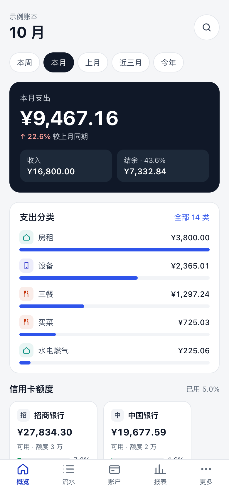
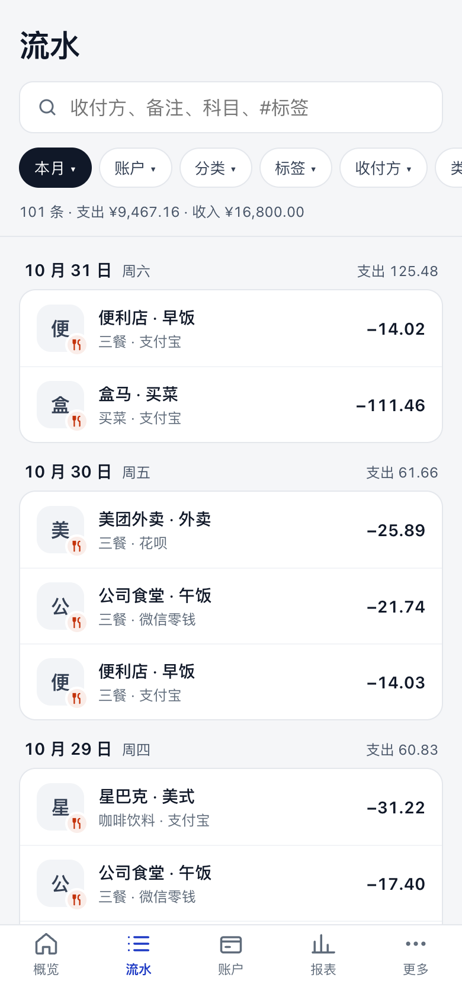
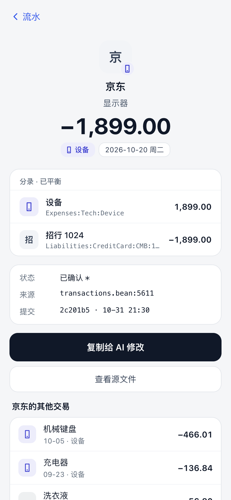
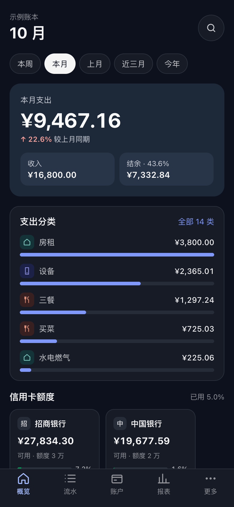
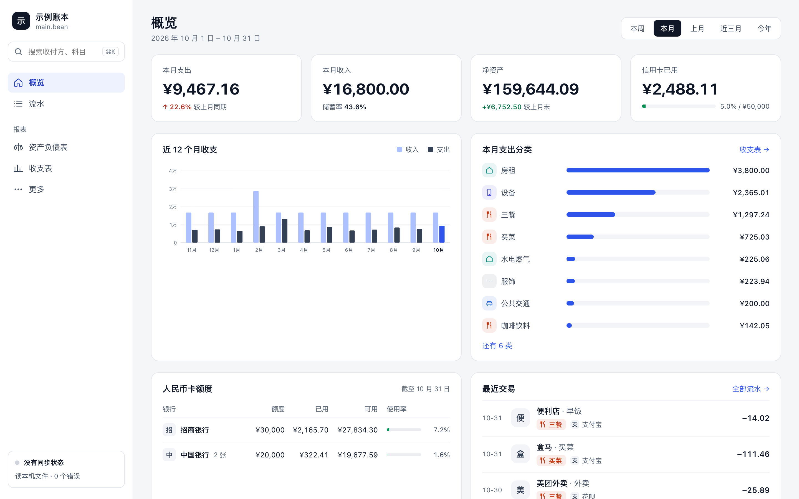
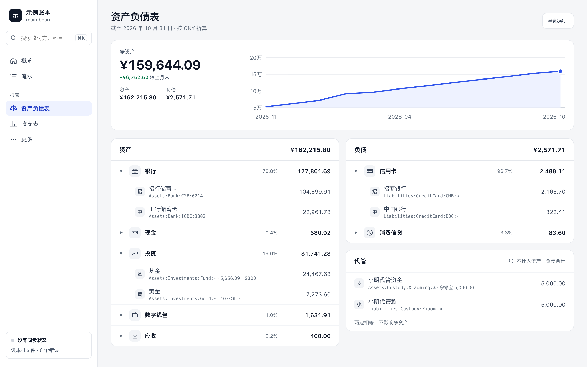

# beanui

手机优先的只读 [Beancount](https://github.com/beancount/beancount) 网页界面，电脑上也好用，可以装成 PWA 加到手机主屏幕。

界面只看不改。想改账时，在交易详情点「复制给 AI 修改」，交易会连同源文件和行号一起复制出来，交给 AI 会话去改账本。

<p>
  
  
  
  
</p>





<sub>截图用的是 `scripts/demo.py` 生成的虚构账本。</sub>

## 功能

- **概览**：可以看本周、本月、上月、近三月、今年。每段有收支、结余率和同期对比，还有支出分类、近 12 个月收支、信用卡额度和最近交易。
- **流水**：按日分组，带每日合计。可以按时间、科目、分类、标签、收付方筛选和搜索；余额断言、开户、备注、价格、文档也能一起看。日期在今天以后的预记交易收在最上面。
- **交易详情**：全部分录、源文件和行号、最后一次提交，以及同一收付方的其他交易。
- **车票**：交易上写了车次、起止站和开车时间，流水里写开车时间，详情页画成一张车票；退票盖章，扣了手续费列出原票价。
- **资产负债表**：资产、负债和净资产，带近 12 个月的走势。外币按 `price` 换算；替别人管的钱单独列出，不计入合计。
- **收支表**：收入和支出按分类分组，和上一段同期对比。
- **品牌图标**：按收付方、摘要和科目认出商家和银行，认不出的显示首字。图标要自己抓，见「配置」。
- **同步**：配合定时 `git pull` 的边车容器，在界面上点「同步」马上拉取账本。

宽屏（≥ 1024px）是侧栏加主区，窄屏是手机布局加底部标签栏，用的是同一个地址。

和 [Fava](https://github.com/beancount/fava) 比，现在还缺试算平衡、持仓、商品价格、BQL 查询、文档、错误列表这些，
也不能在界面上记账。两边的差别和接下来的计划见 [docs/roadmap.md](docs/roadmap.md)。

## 先试一下

要有 [uv](https://docs.astral.sh/uv/) 和 Node.js：

```bash
uv sync
(cd web && npm install && npm run build)
uv run python scripts/demo.py local/demo          # 生成示例账本，截止到今天
LEDGER=local/demo/main.bean uv run python -m beanui.app
```

然后打开 `http://127.0.0.1:8100`。换成自己的账本时，把 `LEDGER` 指向账本的入口文件就行。

| 环境变量 | 说明 |
|---|---|
| `LEDGER` | 必填，账本入口文件。账本或它 include 的文件改动后，下一次请求会重新加载 |
| `CONFIG_DIR` | 配置目录，默认是仓库里的 `config/`，见「配置」 |
| `HOST`、`PORT` | 默认 `127.0.0.1:8100`（镜像里是 `0.0.0.0:8100`） |
| `SYNC_DIR` | 同步请求写到这里，见「同步」；不设就没有「同步」按钮 |

账本用到第三方插件时，先 `uv add --optional plugins <包名>`，再 `uv sync --extra plugins`。内置的 `beancount.plugins.*` 不用加。

## 配置

配置目录里有三样东西，都可以不放：

- **`config.yaml`**：账本约定，包括资产负债表按哪段科目分组、信用卡的科目根和银行名、代管用的科目。
  [`config/config.yaml`](config/config.yaml) 列出了全部默认值，自己的文件里只写要改的项。
- **`brands.yaml`**：收付方到品牌的匹配表，规则写在 [`config/brands.yaml`](config/brands.yaml) 的文件头。
  仓库里是一份常见品牌的示例，按自己的账本增删。
- **`logos/`**：品牌图标。图标都是第三方商标，**不随仓库和镜像发布**，要用脚本按 `brands.yaml` 里写的来源抓到自己的配置目录：

```bash
CONFIG_DIR=/path/to/my-config uv run python scripts/fetch_logos.py      # 补缺的图标，--force 重抓
CONFIG_DIR=/path/to/my-config uv run python scripts/logos_preview.py    # 生成核对页 logos/preview.html
```

也可以直接在账本里写：`open` 上写 `name:` 改显示名、写 `brand:` 指定账户的徽标，交易上写 `brand:` 指定品牌。

### 车票

火车票的交易写上这几个元数据，界面就把它画成车票：

```beancount
2026-11-01 * "铁路12306" "11-07 D1234 青石 → 白沙"
  train: "D1234"
  from: "青石"
  to: "白沙"
  depart: "2026-11-07 18:19"   ; 必填，带日期
  arrive: "20:39"              ; 可选，当天到写时刻，跨天写完整的 "YYYY-MM-DD HH:MM"
  seat: "二等座 05车12F"        ; 可选，随便写
  tickets: 2                   ; 可选，一张时不写
  Liabilities:CreditCard       -286.00 CNY
  Expenses:Transport:Intercity
```

`train`、`from`、`to`、`depart` 四个都有才算车票，摘要怎么写不影响。退票照抄原票的这几项，金额记退回的钱，
界面按金额方向认出是退票；扣了手续费时只记实际退回的钱，另写 `fee: 14.30`（数字），界面用「退回 + 手续费」算出原票价。
界面不联网查时刻表，开车和到站时间要写进账本。

## 部署

镜像是 `ghcr.io/mikusaa/beanui`，有 `linux/amd64` 和 `linux/arm64` 两种。标签有这几种：

- `0.0.1` 这样的版本号，以及 `latest`（最新正式版）
- `edge`：`main` 分支的最新提交
- `sha-<7 位提交号>`

账本仓库要只读挂载进去，并且带上 `.git`，因为提交记录和同步状态都从那里读：

```yaml
services:
  beanui:
    image: ghcr.io/mikusaa/beanui:latest
    user: "1000:1000"
    volumes:
      - /path/to/ledger-repo:/repo:ro
      - /path/to/my-config:/config:ro
    environment:
      - LEDGER=/repo/main.bean
      - CONFIG_DIR=/config
      - TZ=Asia/Shanghai
    ports:
      - "8100:8100"
    restart: unless-stopped
```

手机上要走 HTTPS 才能注册 Service Worker；用 `http://` 也能打开，但不能离线，也不会自动更新。所以前面要放一个反代，反代原样转发后端的 `Cache-Control` 就行：
- 带哈希的 `/assets/*` 缓存一年，标了 `immutable`；
- 其余的都是 `no-cache` 加 ETag。

别给 `/sw.js` 和 `/index.html` 另加缓存。新版上线后，开着的页面会在下次打开或切回前台时自动刷新。

### 同步

界面自己不跑 `git pull`，也不拿密钥。账本在别的机器上提交时，由一个边车容器定时拉取，两边这样约定：

- 边车每次拉取后，在账本仓库写 `.git/sync-status`，只有一行：`ok <UTC 时间> <短提交号>` 或 `error <UTC 时间> <原因>`。
  界面在侧栏和手机首页显示这一行；没有这个文件就不显示。
- 两边共用一个卷，挂到界面的 `SYNC_DIR`。点「同步」时，界面在卷里写一个 `request` 文件；边车看到后先删掉它，再拉取，拉完写 `sync-status`。
- 镜像里的 `/sync` 权限是 `777`，具名卷第一次挂上时会照这个权限建，所以两边用 `user:` 换成别的 uid 也能读写。

## 开发

```bash
uv run pytest
(cd web && npm run typecheck && npm run build)
```

改前端时另开一个 `cd web && npm run dev`，它会把 `/api` 和 `/logos` 转给后端。测试只用 `tests/fixtures/` 下的虚构账本，接口说明见 [docs/api.md](docs/api.md)。

- `beanui/`：后端。`app.py` 是路由，`ledger.py` 加载账本、给交易分类、管科目名，`config.py` 管账本约定，
  `overview.py`、`accounts.py`、`income.py` 分别算各页的数据，`brands.py` 做品牌匹配。
- `web/`：前端。每屏一个组件，手机版和电脑版（`Desktop*.tsx`）分开写；`api.ts` 是接口类型。
- `config/` 是示例配置；`scripts/` 里有生成示例账本、抓图标、生成核对页的脚本。

README 的截图用 `uv run python scripts/demo.py <目录> --end 2026-10-31` 生成的账本，服务端的「今天」也设成 10 月 31 日，
在 390px 和 1440px 宽、2 倍像素下截。

## 许可

[MIT](LICENSE)。品牌名称和图标归各自的所有者。
